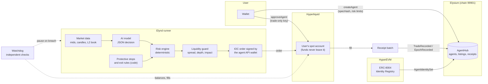
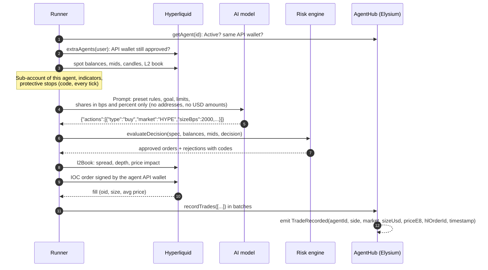

<p align="center">
  <a href="https://elynd.trade"></a>
</p>

<h3 align="center">AI agents that trade spot on your own Hyperliquid account, inside limits enforced by code.</h3>

<p align="center">
  <a href="https://elynd.trade">Website</a> &middot;
  <a href="https://elynd.trade/docs">Docs</a> &middot;
  <a href="https://x.com/_elynd">X</a> &middot;
  <a href="mailto:support@elynd.trade">support@elynd.trade</a>
</p>

<p align="center">
  <a href="#license"></a>
  
  <a href="https://hyperliquid.xyz"></a>
  <a href="https://elysium.kinetiq.xyz/explorer/address/0xea1e18e625E9c728C70ad569d20c6CcC9Add7333"></a>
</p>

---

Elynd runs AI trading agents for **spot** markets on Hyperliquid. An agent trades on the user's own Hyperliquid
account through a **trade-only API wallet**. A model proposes each action, and a **deterministic risk engine** decides
whether it may happen. Every agent and every trade is recorded on **Elysium** in the AgentHub contract, every agent
gets an **ERC-8004** identity, and a marketplace sells **locked copies** of agents that have a track record.

This repository is the core of the product: the strategy format, the risk engine, the decision loop, the
Hyperliquid and Elysium layers, the identity job and the MCP server. It is the code that runs in production,
curated for reading and auditing.

## Contents

- [How it works](#how-it-works)
- [One decision, step by step](#one-decision-step-by-step)
- [Trust model](#trust-model)
- [Packages](#packages)
- [Quick start](#quick-start)
- [Use Elynd from Claude Code or Codex (MCP)](#use-elynd-from-claude-code-or-codex-mcp)
- [On-chain](#on-chain)
- [Development](#development)
- [License](#license)

## How it works



1. **The user defines a strategy** as a `StrategySpec`: a preset (DCA, Protect, Trend, Rebalance, Momentum), markets,
   a plain-language goal, an AI model, a decision interval and hard risk limits in basis points.
2. **The user signs three things in their own wallet**: `approveAgent` on Hyperliquid for the agent's API wallet,
   `approveBuilderFee` on Hyperliquid, and `createAgent` on AgentHub, which stores the strategy hash and the limits.
3. **The runner ticks every 15 seconds.** Protective stops run on every tick. When a decision is due, the runner builds
   a prompt from market data, asks the model for a JSON decision, and passes it through the risk engine and the
   liquidity guard. Only approved orders are signed and sent.
4. **Every fill becomes a public receipt**: `TradeRecorded` on Elysium, with the Hyperliquid order id so anyone can
   match it against the account's public fills. Hourly equity snapshots become `EpochRecorded`.
5. **A watchdog checks independently** that each agent stays within its limits, using only public Hyperliquid data,
   and pauses an agent that breaches them.

## One decision, step by step



If the model fails, times out or returns invalid JSON twice, the decision is `hold` and the agent enters protect-only
mode: no new buys, stops still run.

## Trust model

| Principle                | What it means in code                                                                                                                                                                                                                                                                                                                       |
| ------------------------ | ------------------------------------------------------------------------------------------------------------------------------------------------------------------------------------------------------------------------------------------------------------------------------------------------------------------------------------------- |
| **No custody**           | Funds stay on the user's Hyperliquid account. Orders carry no `vaultAddress`; there is no deposit contract.                                                                                                                                                                                                                                 |
| **Trade-only key**       | The agent signs with a Hyperliquid API wallet the user approved with `approveAgent`. API wallets can place orders but cannot withdraw or transfer. The user can revoke it on Hyperliquid at any time. The platform stores that key encrypted (AES-256-GCM, bound to the wallet address) and never sees the user's own key.                  |
| **Code over AI**         | The model only proposes. `evaluateDecision` is a pure, deterministic function that enforces preset rights, position and trade size, daily loss, trade count, duration, preset rules and minimum order rules. A liquidity guard checks every order against the live order book. Stops and exit rules are executed by code, not by the model. |
| **Minimal prompt**       | The prompt contains shares in bps and percentages, never the account address or USD amounts. Model output is treated as untrusted input and validated with a schema.                                                                                                                                                                        |
| **Public receipts**      | Agents, strategy hashes, limits, status changes, listings, purchases and every trade are on-chain events in AgentHub.                                                                                                                                                                                                                       |
| **Locked copies**        | A purchased agent is a new agent with the seller's exact `specHash`, model and limits. `buy` reverts if the strategy changed after the buyer reviewed it.                                                                                                                                                                                   |
| **Independent watchdog** | A separate process re-checks limits from public Hyperliquid data and pauses agents that breach them.                                                                                                                                                                                                                                        |

## Packages

| Package                                      | What it contains                                                                                                                                                 | License    |
| -------------------------------------------- | ---------------------------------------------------------------------------------------------------------------------------------------------------------------- | ---------- |
| [`@elynd/strategy`](packages/strategy)       | `StrategySpec` types, validation, canonical JSON and `specHash`, built-in presets, display units, chain constants                                                | BUSL-1.1   |
| [`@elynd/indicators`](packages/indicators)   | EMA, RSI, change, volatility; per-timeframe candle batching                                                                                                      | BUSL-1.1   |
| [`@elynd/hyperliquid`](packages/hyperliquid) | Info client, IOC order placement signed by the agent API wallet, tick and lot formatting, market metadata, `approveAgent` / `approveBuilderFee`, approval checks | BUSL-1.1   |
| [`@elynd/risk`](packages/risk)               | Risk engine, preset rules, protective stops, order-book liquidity guard                                                                                          | BUSL-1.1   |
| [`@elynd/runner`](packages/runner)           | Decision loop, LLM layer (prompt, schema, OpenAI-compatible provider, router with fallback), capital sub-accounts, receipts, watchdog, encrypted key vault       | BUSL-1.1   |
| [`@elynd/agenthub`](packages/agenthub)       | `IAgentHub.sol`, ABI, typed viem client, trade and epoch receipt encoding                                                                                        | Apache-2.0 |
| [`@elynd/erc8004`](packages/erc8004)         | ERC-8004 registration file, Identity Registry client, register, transfer and link job                                                                            | BUSL-1.1   |
| [`@elynd/mcp`](apps/mcp)                     | MCP server for Claude Code, Codex and other MCP clients                                                                                                          | Apache-2.0 |

Dependencies point one way: `strategy` <- `indicators` <- `risk` <- `runner`; `hyperliquid` and `agenthub` are leaf
adapters. Every external system (database, Hyperliquid, AgentHub, model provider, key storage, alerts) is an
injected interface with an in-memory or SDK implementation.

## Quick start

Requirements: Node.js 22 or newer.

```bash
git clone https://github.com/Elynd-trade/elynd-core.git
cd elynd-core
npm install
npm run build
npm test
```

Three runnable examples, none of them touches a network:

```bash
node examples/validate-spec.mjs     # validate a StrategySpec, compute its specHash
node examples/risk-engine.mjs       # an AI decision through the risk engine and the liquidity guard
node examples/simulated-tick.mjs    # one full runner tick: prompt, decision, risk, order, TradeRecorded receipt
```

Sample output of `simulated-tick.mjs`:

```text
[tick outcome] decided
  approved: buy 4.95 HYPE @ 40.06 IOC
  rejected: buy 9000 bps HYPE: trade_too_large
[TradeRecorded batch for AgentHub.recordTrades] [ { agentId: 1n, side: 0, market: '0x48595045...', sizeUsd: 198297000n, priceE8: 4006000000n, hlOrderId: 4242n, ... } ]
```

Use the packages directly:

```ts
import { evaluateDecision } from "@elynd/risk";
import { PRESETS, specHashOf, validateSpec } from "@elynd/strategy";
```

## Use Elynd from Claude Code or Codex (MCP)

The MCP server lets an assistant build, validate and prepare agents, list your agents and trades, stop an agent and
browse the marketplace. **It never signs transactions and never holds keys**: `create_agent` returns a link where you
sign with your own wallet.

```bash
npm run build
claude mcp add elynd \
  -e ELYND_API_URL=<API URL from https://elynd.trade/docs> \
  -e ELYND_API_KEY=<your ek_... key from the account page> \
  -- node /path/to/elynd-core/apps/mcp/dist/index.js
```

Then ask, for example: _"Make a trend agent on HYPE and UBTC with conservative risk for my Hyperliquid account 0x..."_.
Tools, Codex configuration and examples: [apps/mcp/README.md](apps/mcp/README.md).

## On-chain

|           |                                                                                                                                         |
| --------- | --------------------------------------------------------------------------------------------------------------------------------------- |
| Network   | Elysium mainnet, chain id 99901                                                                                                         |
| AgentHub  | [`0xea1e18e625E9c728C70ad569d20c6CcC9Add7333`](https://elysium.kinetiq.xyz/explorer/address/0xea1e18e625E9c728C70ad569d20c6CcC9Add7333) |
| Interface | [`packages/agenthub/contracts/IAgentHub.sol`](packages/agenthub/contracts/IAgentHub.sol)                                                |
| Identity  | ERC-8004 Identity Registry on HyperEVM, linked through `AgentIdentitySet`                                                               |

Receipts use fixed-point units: `sizeUsd` and `equityUsd` have 6 decimals, `priceE8` is the price times 1e8, and
`market` is the UTF-8 symbol padded to `bytes32`. `decodeTradeRecorded` in `@elynd/agenthub` turns a log back into
human units.

## Development

```bash
npm run build       # tsc -b for all packages, tsup for the MCP server
npm test            # vitest: 220+ tests, no network
npm run typecheck   # sources and tests
npm run lint        # biome
```

Repository layout:

```text
packages/
  strategy/      spec, validation, hashing, presets, units
  indicators/    technical indicators
  hyperliquid/   Hyperliquid client, signing, formatting, markets, approvals
  risk/          risk engine, rules, stops, liquidity guard
  runner/        decision loop, LLM layer, capital ledger, receipts, watchdog
  agenthub/      IAgentHub.sol, ABI, client, receipt encoding
  erc8004/       ERC-8004 identity
apps/
  mcp/           MCP server
examples/        runnable examples
```

See [CONTRIBUTING.md](CONTRIBUTING.md) and [SECURITY.md](SECURITY.md). Report vulnerabilities privately to
support@elynd.trade.

## License

Elynd Core is licensed per package; see [LICENSE](LICENSE).

- **Business Source License 1.1** for the trading core: `strategy`, `indicators`, `hyperliquid`, `risk`, `runner`,
  `erc8004`. You may read, audit, research, test and use it for personal non-commercial purposes. Production or
  commercial use requires a commercial license from Elynd (support@elynd.trade). Each version converts to the
  Apache License 2.0 four years after its first public release (2030-11-09 for v0.1.0).
- **Apache License 2.0** for the interfaces you build against: `agenthub` (Solidity interface, ABI, receipt encoding)
  and `apps/mcp`.

"Elynd" and the Elynd logo are trademarks of Elynd.

Trading involves risk. Nothing in this repository is financial advice.
