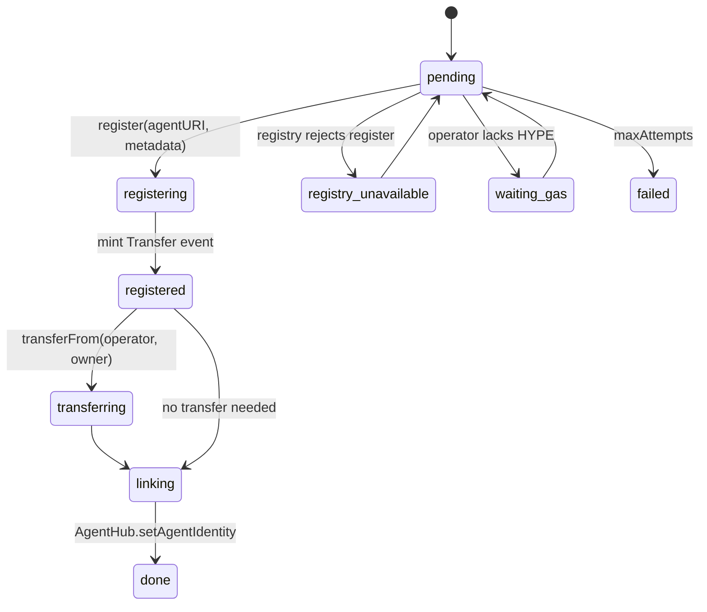

# @elynd/erc8004

Every Elynd agent gets an [ERC-8004](https://eips.ethereum.org/EIPS/eip-8004) identity: an NFT in the Identity
Registry on HyperEVM whose `agentURI` points to a public registration file, linked back to the agent's record in
AgentHub on Elysium.

## The job

`Erc8004Service` moves each agent forward one step per tick. Every step is idempotent: it first checks the stored
transaction or the on-chain state, and sends a new transaction only if there is none.

The operator registers and pays gas, then transfers the NFT to the agent owner (`ERC8004_TRANSFER_TO_OWNER=true`),
so the owner of the identity is the owner of the agent. On-chain metadata `agentHub` / `agentHubId` points back to
AgentHub.

## Registration file

`buildRegistrationFile` produces the `registration-v1` JSON. It publishes only what the marketplace already shows:
preset, risk limits, markets, status, `specHash`, the AgentHub record and the API wallet. A strategy's goal and
parameters are never published, and a purchased (locked) copy gets a neutral name.

## Configuration

| Variable                                    | Default                                                      |
| ------------------------------------------- | ------------------------------------------------------------ |
| `ERC8004_ENABLED`                           | `false`                                                      |
| `ERC8004_RPC_URL`                           | public HyperEVM RPC for the network                          |
| `ERC8004_REGISTRY`                          | canonical Identity Registry (`ERC8004` in `@elynd/strategy`) |
| `ERC8004_TRANSFER_TO_OWNER`                 | `true`                                                       |
| `ERC8004_POLL_SEC` / `ERC8004_MAX_ATTEMPTS` | `30` / `10`                                                  |
| `PUBLIC_API_URL`                            | base URL of the `agentURI`                                   |

Storage (`IdentityStore`) and the agent source are injected; `MemoryIdentityStore` is provided.

## License

BUSL-1.1, see [LICENSE](./LICENSE).
